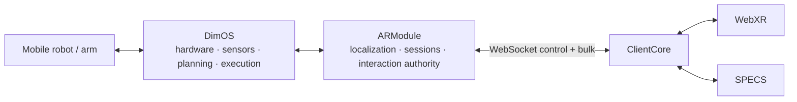

<h1 align="center">Augmented Reality: the Interface for Physical AI</h1>

<p align="center">
  <a href="https://github.com/V4C38/spectacles-dimensional-os"></a>
  <a href="LICENSE"></a>
  <a href="https://github.com/V4C38/spectacles-dimensional-os/stargazers"></a>
  <a href="https://github.com/V4C38/spectacles-dimensional-os/network/members"></a>
  <a href="https://github.com/V4C38/spectacles-dimensional-os/graphs/contributors"></a>
</p>

<p align="center">
  
  
</p>

<p>
  An augmented reality interface for observing, directing, and collaborating with physical AI. Built on <a href="https://github.com/dimensionalOS/dimos">Dimensional OS</a>, it brings navigation, arm manipulation, robot sensor data, and shared spatial interaction to WebXR and Snap Spectacles through one device-independent ARModule.
</p>

<p align="center">
  
</p>

<p align="center">
  <a href="#supported-hardware">Hardware</a> •
  <a href="#capabilities">Capabilities</a> •
  <a href="#setup">Setup</a> •
  <a href="#clients">Clients</a> •
  <a href="#armodule">ARModule</a> •
  <a href="#contributing">Contributing</a>
</p>

## Supported Hardware

Two robot categories share the same interface: mobile robots, represented by Unitree Go2, and robot arms, represented by OpenYAM.

<details>
<summary><strong>Robots and headsets</strong></summary>

| Category | Current example | Interaction |
| --- | --- | --- |
| Mobile robots — quadrupeds, rovers, humanoids | **Unitree Go2 Pro / Air** | Navigation, manual control, sensor visualization, and agent interaction |
| Robot arms | **OpenYAM** | Following, IK preview, checked trajectory execution, and gripper control |

Go2 and OpenYAM are the current integrations; other robots need a DimOS composition and matching capabilities. The categories are intended to accommodate additional robot types.

| Client | Target hardware |
| --- | --- |
| WebXR | Meta Quest 3 / Quest 3S |
| SPECS | Snap Spectacles 2024 developer kit, Lens Studio 5.15 |

Simulated and recorded sources support development without a physical robot. OpenYAM planning uses the optional manipulation dependencies.

</details>

## Capabilities

See robot state in the room, interact with spatial targets, and share the same robot across clients. Available controls follow the capabilities advertised by DimOS.

<details>
<summary><strong>What you can do</strong></summary>

- **Navigate:** place and drag goals, choose arrival heading, inspect planned routes, or use joystick control.
- **Manipulate:** move an arm target, preview IK and trajectories, execute a checked plan, and control the gripper.
- **Visualize:** see robot poses, LiDAR, paths, arm geometry, and dashed arm outlines in world space.
- **Localize:** align the headset and robot using robot-mounted AprilTags, VPS, or both.
- **Collaborate:** observe a shared robot from multiple clients, with one editing authority at a time and explicit handover.
- **Use agents:** send voice commands from Spectacles and see agent actions through the same spatial interface.
- **Develop without hardware:** use simulated robots and recorded data.

<p align="center">
  
</p>

</details>

## Setup

Start with the local launcher: it installs DimOS, selects the robot and client, and configures localization. Use Python 3.12 and Node 22 (`nvm use`).

<details>
<summary><strong>Launcher, localization, and DimOS installation</strong></summary>

### Launcher — preferred

Double-click [Start Launcher.command](launcher/Start%20Launcher.command), or run from the repository root:

```sh
./launcher/scripts/start-launcher.sh
```

1. Open **http://127.0.0.1:8790** and keep its terminal open.
2. Reuse an existing DimOS installation or choose a checkout and press **Install**. The tested revision is recorded in [`.dimos-revision`](.dimos-revision).
3. Select **Go2** or **OpenYAM**, a **Device**, **Simulated**, or **Recording** source, and **WebXR** or **Specs**. Enable manipulation dependencies for arm planning.
4. Choose localization, press **Start**, and connect the client using the displayed PIN or connection URL.

Keep the host, headset, and physical robot on the same reachable network. Setup applies the required macOS network settings and may request administrator access. Agent mode also needs an `OPENAI_API_KEY` and internet access on the host.

### Localization — AprilTags / VPS

- **AprilTags:** print a [36h11 marker](assets/markers/) at 100% scale: the supplied sticker is 70 mm overall with a 56 mm black square. Mount it rigidly on the robot and configure its ID, size, and pose in the launcher. Go2 includes a default mount profile.
- **VPS:** select the MultiSet provider, enter its credentials and map code, and use a mapped environment.
- **In the client:** follow the setup wizard, keep the robot still, and capture observations. For AprilTags, start around 0.5–1.5 m from the tag. A successful result aligns robot and headset coordinates.

### DimOS — CLI alternative

The launcher handles installation. For terminal setup, the repository script installs DimOS and `dimos-ar` into the same environment:

```sh
./launcher/scripts/setup.sh --yes --clone-dir ../dimos --dimos-ref "$(cat .dimos-revision)"
./launcher/scripts/start.sh --blueprint unitree_go2_ar
```

To reuse an installation, pass `--dimos-python /path/to/dimos/.venv/bin/python3` instead of `--clone-dir`. Add `--manipulation` when installing for OpenYAM. Robot configuration lives in `~/.config/dimos/config`; the launcher writes it for you. See the [DimOS compatibility notes](docs/dimos-compatibility.md) for installation details and the [arm guide](dimos-ar/dimos/ar/manipulation/README.md) for OpenYAM and mock commands.

</details>

## Clients

WebXR and SPECS provide platform-specific input and rendering over the same portable ClientCore. Both connect to ARModule and present its shared robot state.

<details>
<summary><strong>WebXR, SPECS, and ClientCore</strong></summary>

### WebXR

A browser client built with Three.js and WebXR, supporting hand and controller input. Start it from the launcher, open the displayed **HTTPS LAN URL** in the headset browser, select the headset profile, and enter AR. The headset must trust the HTTPS certificate.

For development:

```sh
cd clients/webxr
npm ci
npm run dev
```

Run ARModule on the same host for the default `/ar` proxy. The shipped WebXR page connects to that same-origin backend; it has no remote PIN entry flow. See the [WebXR guide](clients/webxr/README.md).

### SPECS

A native Lens Studio client for Spectacles, using hand interaction, spatial panels, camera capture, and speech. Open [the Lens project](clients/specs/spectacles-dimensional-os.esproj) in **Lens Studio 5.15**, send it to Spectacles, and follow the setup wizard using the launcher's PIN or Host IP. The wrist menu opens runtime controls and settings from either palm.

<p align="center">
  
</p>

### ClientCore

[ClientCore](clients/specs/Assets/Scripts/DimOSARClient/) owns the shared protocol, sessions, interaction authority, navigation, and manipulation behavior. Each host supplies its own input, coordinate conversion, and rendering; platform APIs stay outside the core.

</details>

## ARModule

ARModule is the Python module that connects DimOS services to AR clients. DimOS owns robot hardware, planning, and execution; ARModule adapts those services into spatial state and interactions.

<details>
<summary><strong>Architecture, data flow, and protocol</strong></summary>



Robot poses, sensor data, routes, and arm state flow from DimOS through ARModule to the clients. Clients return spatial targets, commands, headset poses, and requested localization observations. Localization aligns the client's tracking frame with robot `odom`; each host converts into its own rendering coordinates.

The Python package lives in [`dimos-ar/dimos/ar/`](dimos-ar/dimos/ar/):

| Area | Responsibility |
| --- | --- |
| `module.py` | DimOS module composition and input/output surface |
| `websocket/` | Client sessions, control messages, and bulk transport |
| `localization/` | AprilTag and VPS capture episodes and alignment |
| `navigation/`, `robot/`, `sensors/` | Navigation adaptation, robot state, and sensor presentation |
| `manipulation/` | Arm service adaptation, editing authority, and native planning/execution boundaries |

The [protocol](dimos-ar/PROTOCOL.md) separates two lanes:

- **Control:** handshake and capabilities, shared state, editing leases, target updates, command results, and operation status.
- **Bulk:** LiDAR, localization images, robot models, route points, and checked trajectories, bound to the same control session.

One backend represents one robot; multiple clients can connect. ARModule grants editing authority, while accepted motion remains owned by the robot stack. Larger transfers use a separate lane so they do not queue ahead of control messages.

See the [architecture reference](docs/architecture.md) and [DimOS compatibility boundary](docs/dimos-compatibility.md) for implementation details.

</details>

## Contributing

Contributions, new robot integrations, clients, and bug reports are welcome. Start with the contributor guide and keep each concern under one owner.

<details>
<summary><strong>Development and pull requests</strong></summary>

Read [CONTRIBUTING.md](CONTRIBUTING.md) for structure and architecture rules, and [AGENTS.md](AGENTS.md) for repository workflows. Reuse ClientCore, import installed DimOS, and update both protocol implementations alongside the protocol document.

Follow [the validation checkpoint policy](AGENTS.md#commit--pull-request-guidelines); the complete gate is:

```sh
./launcher/scripts/run-ci.sh
```

PRs should explain behavior changes, report validation, and include captures for visual changes. Native editor tests and the [hardware validation checklist](docs/hardware-validation.md) complement the automated gate.

Generated reports, coverage, recordings and disposable test projects default to the ignored repository-root `Review Data/` folder. See the [integration contract](tools/integration-tests/README.md) for client outputs and explicit output overrides.

The latest verified golden videos are always at **`Review Data/webxr_golden-path.mp4`** and **`Review Data/specs_golden-path.mp4`**. Each client replaces its own video only after a complete successful golden run; failed or incomplete runs preserve the previous video.

</details>

## Known Issues

Tracking, network quality, and robot feedback affect spatial accuracy and responsiveness. Hardware validation remains separate from simulated, browser, and editor checks.

<details>
<summary><strong>Current limitations and troubleshooting</strong></summary>

- **Pose drift:** robot odometry and headset tracking can diverge during movement. New localization observations realign the overlay; restart localization when needed.
- **Arm timing:** the mock benchmark measured following taking 1.49–2.53× as long as Execute at the same speed setting. Controller tuning is unchanged; see [measured results](docs/dimos-compatibility.md#mock-arm-arrival-timing).
- **OpenYAM collision model:** the current adapter derives missing collision geometry from canonical visual meshes. Software checks do not establish physical collision accuracy; see [compatibility notes](docs/dimos-compatibility.md#openyam-collision-geometry).
- **Connection:** use the displayed LAN address or PIN, keep devices reachable on the same network, and trust the WebXR HTTPS certificate on the headset.
- **AprilTag detection:** check print scale, configured mount pose, lighting, and viewing distance.

See [native testing](clients/specs/tools/README.md) and the [hardware validation checklist](docs/hardware-validation.md) for device-specific checks.

</details>

MIT License — see [LICENSE](LICENSE).
