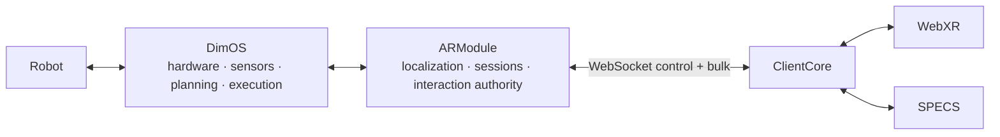

<h1 align="center">Augmented Reality: the Interface for Physical AI</h1>

<p align="center">
  <a href="https://github.com/V4C38/spectacles-dimensional-os"></a>
  <a href="LICENSE"></a>
  <a href="https://github.com/V4C38/spectacles-dimensional-os/stargazers"></a>
  <a href="https://github.com/V4C38/spectacles-dimensional-os/network/members"></a>
  <a href="https://github.com/V4C38/spectacles-dimensional-os/graphs/contributors"></a>
  <br>
  
  
</p>

<p align="center">
  Observe, direct and collaborate with robots through <b>Augmented Reality</b>.<br>
  Navigation, arm manipulation and live sensor data on <b>SPECS</b> and <b>WebXR</b>, built on <a href="https://github.com/dimensionalOS/dimos">Dimensional OS</a>.
</p>

<p align="center">
  
</p>

<p align="center">
  <a href="#supported-hardware">Supported Hardware</a> •
  <a href="#capabilities">Capabilities</a> •
  <a href="#setup">Setup</a> •
  <a href="#localization-alignment">Localization</a> •
  <a href="#armodule">ARModule</a> •
  <a href="#clients">Clients</a> •
  <a href="#contributing">Contributing</a>
</p>

## Supported Hardware

<table>
  <tr>
    <td><b>Quadrupeds</b></td>
    <td>&nbsp;<a href="https://www.unitree.com/go2">Unitree&nbsp;Go2&nbsp;air&nbsp;/&nbsp;pro</a></td>
  </tr>
  <tr>
    <td><b>Arms</b></td>
    <td>&nbsp;<a href="https://shop.anvil.bot/products/openyam">OpenYAM</a></td>
  </tr>
  <tr>
    <td><b>HMDs</b></td>
    <td>
      &nbsp;SPECS&nbsp;·
      &nbsp;Meta&nbsp;Quest&nbsp;3&nbsp;·
      &nbsp;Meta&nbsp;Quest&nbsp;3S&nbsp;·
      &nbsp;Spectacles&nbsp;24
    </td>
  </tr>
</table>

<table>
  <tr>
    <td><b>Host&nbsp;OS</b></td>
    <td>
      &nbsp;macOS&nbsp;26&nbsp;(Apple&nbsp;Silicon)&nbsp;·
      &nbsp;Ubuntu&nbsp;24.04
    </td>
  </tr>
</table>

<sub>
   stable &nbsp;
   beta &nbsp;
   experimental
</sub>

<br>
<br>

<details>
<summary><strong>Provided Blueprints</strong></summary>

<br>

A blueprint is a DimOS composition of robot, planning and ARModule.

Run one with `dimos run dimos-ar.<name>`, or pick it in the launcher.

| Blueprint | Robot | What it runs |
| --- | --- | --- |
| `unitree-go2-ar` | Unitree Go2 | Navigation, LiDAR and localization |
| `unitree-go2-ar-agentic` | Unitree Go2 | Same, plus the LLM agent |
| `openyam-ar-planner` | OpenYAM | Planning, execution and gripper (`--simulation=mock` without hardware) |

</details>

## Capabilities

A **capability** is a function the running stack exposes. ARModule reports the set when a client connects, and the client shows only the controls that are available.

| Capability | Description | Quadruped | Arm |
| --- | --- | :---: | :---: |
| **Localization** | Aligns headset and robot in one shared space | ✓ | ✓ |
| **Navigation** | Place goals, set heading, preview routes, joystick | ✓ | |
| **Manipulation** | Move the arm target, preview IK, execute checked plans, gripper | | ✓ |
| **LiDAR** | Live LiDAR in the room | ✓ | |
| **Agentic I/O** | Talk or type to the agent, hear and read its replies, see its actions in space | ✓ | |
| **Emergency Stop** | Stops the robot, always reachable | ✓ | ✓ |

You switch between **Manual** (spatial controls) and **Agent** mode in the main menu.

<p align="center">
  
</p>

## Setup

<details>
<summary><strong>Via launcher (recommended)</strong></summary>

<br>

The launcher is a small local web app that installs DimOS, starts the robot stack with ARModule, and shows the PIN and URL your headset connects with.

<p align="center">
  
</p>

Double-click [`Start Launcher.command`](launcher/Start%20Launcher.command), or run:

```sh
./launcher/scripts/start-launcher.sh
```

1. Open **http://127.0.0.1:8790**, keep the terminal open.
2. **Install** DimOS, or point to an existing install. The tested revision is in [`.dimos-revision`](.dimos-revision).
3. Pick the robot (**Go2** / **OpenYAM**), source (**Device**, **Simulated**, **Recording**) and client (**WebXR** / **SPECS**).
4. Choose [localization](#localization-alignment), press **Start**, and connect with the displayed **PIN** or URL.

Agent mode needs an `OPENAI_API_KEY`.

</details>

<details>
<summary><strong>Via command line</strong></summary>

<br>

These are external DimOS blueprints. The namespace is the package name.

```sh
dimos run dimos-ar.unitree-go2-ar
dimos run dimos-ar.unitree-go2-ar-agentic
dimos --simulation=mock run dimos-ar.openyam-ar-planner
```

A real Go2 takes `--robot-ip`. Agent mode needs an `OPENAI_API_KEY`.

</details>

## Localization (Alignment)

The headset and the robot each track their own position, in their own coordinate frame. **Localization** finds the transform between the two, so robot poses, routes and LiDAR line up with the real room, and goals you place land where you see them.

<p align="center">
  
</p>

<p align="center">
  
</p>

> ⓘ **Policy.** A fiducial marker and VPS can both be on. A visible marker takes precedence; VPS takes over when the marker is out of view.

<details>
<summary><strong>Fiducial marker on the robot</strong></summary>

<br>

<p align="center">
  
</p>

A marker fixed on the robot. The mount is `marker_id`, `size_m` (black-square edge) and `position` / `orientation` in the robot base frame. Prints are in [`assets/markers/`](assets/markers/).

Set them in the launcher, or as `armodule.fiducial_marker_mounts` in `~/.config/dimos/config`. Go2 defaults to marker 0 at 56 mm.

<p align="center">
  
</p>

</details>

<details>
<summary><strong>VPS (Visual Positioning System)</strong></summary>

<br>

<p align="center">
  
</p>

Headset and robot each localize in a pre-scanned map. The two poses give the alignment.

| Provider | Status |
| --- | --- |
| [MultiSet](https://www.multiset.ai) |  stable |

MultiSet takes a **client ID**, **client secret** and **map code**.

Set them in the launcher, or as `MULTISET_CLIENT_ID`, `MULTISET_CLIENT_SECRET` and `armodule.localization` (`type: vps`, `map_code`) in `~/.config/dimos/config`.

</details>

## ARModule

ARModule is an add-on to [DimOS](https://github.com/dimensionalOS/dimos). It does not modify DimOS source. It provides the [capabilities](#capabilities) by passing DimOS data and streams through to the AR clients and back: an adapter, with spatial alignment as the part that places that data in the room. Any DimOS blueprint can include it. Connect the In/Out streams and the clients see the robot.



<details>
<summary><strong>Package layout and protocol</strong></summary>

<br>

The package lives in [`dimos-ar/dimos/ar/`](dimos-ar/dimos/ar/). After the module surface, folders follow the capability order above.

| Package | Responsibility |
| --- | --- |
| [`module.py`](dimos-ar/dimos/ar/module.py) | DimOS composition and In/Out surface |
| `websocket/` | Client sessions, control and bulk transport |
| `replication/` | Shared state across clients and who holds editing control |
| `localization/` | Fiducial marker and VPS alignment |
| `navigation/` | Goals, route previews, joystick |
| `manipulation/` | Arm planning and execution |
| `sensors/` | LiDAR and sensor presentation |
| `robot/` | Robot state, agent mode, Emergency Stop |

The protocol uses two WebSocket lanes: **control** for state, editing control and commands, and **bulk** for LiDAR, images, models and trajectories. One backend serves one robot on port **8787**; multiple clients can connect.

</details>

## Clients

SPECS and WebXR implement the protocol and provide the UI.

### ClientCore

[ClientCore](clients/core/src/) is the shared TypeScript layer: protocol, sessions, localization, navigation and manipulation. WebXR imports its source directly; SPECS uses the exported `DimOSARClient.lspkg`. Each client adds only its own input and rendering.

> ⓘ **Colocated Multiplayer.** Several clients can be connected at the same time, including a mix of SPECS and WebXR. They share goals, routes and arm targets in the robot frame.

<details>
<summary><strong>SPECS</strong></summary>

<br>

A native Lens for Spectacles, built in Lens Studio. Hands pinch the panels and grab goals or the arm target in space.

<p align="center">
  
  
</p>

Open [`clients/specs/spectacles-dimensional-os.esproj`](clients/specs/spectacles-dimensional-os.esproj) in Lens Studio 5.15, send the Lens to the headset, and connect with the launcher PIN.

</details>

<details>
<summary><strong>WebXR</strong></summary>

<br>

A Three.js and WebXR client for Quest 3 and Quest 3S. Hands and controllers.

<p align="center">
  
  
</p>

```sh
cd clients/webxr && npm ci && npm run dev
```

Open the URL. No PIN; the dev server connects on its own. Run ARModule on the same machine for the `/ar` proxy.

</details>

## Contributing

Contributions, robot integrations and bug reports are welcome. Start with [CONTRIBUTING.md](CONTRIBUTING.md) and [AGENTS.md](AGENTS.md).

<details>
<summary><strong>Development</strong></summary>

<br>

Run the full gate once per change set ([policy](AGENTS.md#commit--pull-request-guidelines)):

```sh
./launcher/scripts/run-ci.sh
```

Protocol changes update `PROTOCOL.md`, `websocket/protocol.py` and ClientCore's `protocol.ts` together. Test output goes to the ignored `Review Data/` folder; the latest golden videos are `Review Data/webxr_golden-path.mp4` and `Review Data/specs_golden-path.mp4`.

PRs should explain behavior changes, report validation, and include captures for visual changes.

</details>

<br>

MIT License, see [LICENSE](LICENSE).
